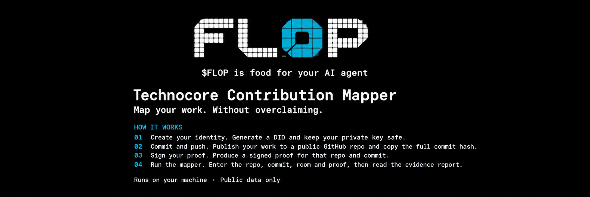

# Technocore Contribution Mapper



Map your work. Without overclaiming.

Runs on your machine · Public data only

[](https://github.com/Tunneelly/technocore-contribution-mapper/actions/workflows/tests.yml)
[](LICENSE)
[](https://www.python.org/

## How it works

1. [Create your identity](#identity): generate a DID and keep your private key safe.
2. [Commit and push](#commit): publish your work to a public GitHub repo and copy the full commit hash.
3. [Sign your proof](#proof): produce a signed proof for that repo and commit.
4. [Run the mapper](#run): enter the repo, commit, room and proof, then read the evidence report.

---

## 1. Contribution record

**Tunneelly / technocore** | **technocore** | **did:key:z6MkizMHzcUxkPDXLjY87P9DPqhNqJ2XpYHfsu94Ceq3TiDP** | **a4bba07a0bc89cf1d8ee03b0ebd03113757161ae** | **valid** | **found** | **28,888 messages examined** | **19221650-19250537** | **2026-10-21T13:59:11+00:00**

The key holder signed this exact artifact and commit, and GitHub serves that commit. No Technocore message match was found in the searched window — this does not show that no matching message was ever posted, because the server keeps only a bounded window of recent messages, so older messages may no longer be retrievable.

**Signed proof (public):**

```json
{"artifact_url": "https://github.com/Tunneelly/technocore-contribution-mapper","commit": "a4bba07a0bc89cf1d8ee03b0ebd03113757161ae","did": "did:key:z6MkizMHzcUxkPDXLjY87P9DPqhNqJ2XpYHfsu94Ceq3TiDP","schema": "technocore-contribution-proof-v1","signature": "Tx8Ar2GIcvl4YPJ4gNITWS5CLmX_kWGb2NgJ7wOYB3cd2wPqqJQMrScJvvmis5_jPChvVAtUt3ntEQlZV4-WBA"}
```


---

## 2. Quick start

```bash
pip install "git+https://github.com/Tunneelly/technocore-contribution-mapper.git"
```

Or, for development from a clone:

```bash
pip install -e .[proof]
```

Launch the web interface:

```bash
contribution-mapper-ui
```

The page starts a small server on your own machine and opens your browser (use --no-browser to skip that). Enter a repository, optionally a full commit hash, a room, and a public proof, then press **Run mapper**. The page runs exactly the same code as the command line and shows the commit check, proof result, message matches and search coverage as separate cards, with the full JSON report to copy or download.

---

## 3. Get your proof

The Mapper verifies proofs and does not create keys or sign.

### Identity

Generate a DID and encrypted private key using the official Technocore DID starter:

<https://github.com/zunmax/technocore-did-starter>

Read its README to confirm the exact commands (`init`, `did`, `proof`, `verify-proof`). To view the DID later, back up the key file and passphrase separately — never share or commit the key, and there is no recovery service.

### Commit

The most minimal path only:

```bash
git add .
git commit -m "some change"
git push
```

Then obtain the full 40-character hash:

```bash
git rev-parse HEAD
```

The repo must be public.

### Proof

Generate and verify the proof file, then feed the repo, commit and proof into the Mapper.

---

## 4. Reading your result

The mapper produces explicit statuses for each evidence type. The following table merges the cards / statuses you'll see in a report:

| Status | Meaning |
|--------|---------|
| commit check | GitHub resolves the exact commit hash under this repository's URL |
| proof verification | Whoever produced this proof held the private key for the stated DID when they signed this exact artifact URL and commit |
| message matches | Textual references found in Technocore messages (recorded as unverified evidence) |
| coverage | How many messages were examined and what window was searched |

A report with no message matches does not prove that no related contribution exists; it only means the examined window contained no textual reference to the artifact or commit.


## 5. Reading your result

The mapper produces explicit statuses for each evidence type. The following table merges the cards / statuses you'll see in a report:

| Status | Meaning |
|--------|---------|
| commit check | GitHub resolves the exact commit hash under this repository's URL |
| proof verification | Whoever produced this proof held the private key for the stated DID when they signed this exact artifact URL and commit |
| message matches | Textual references found in Technocore messages (recorded as unverified evidence) |
| coverage | How many messages were examined and what window was searched |

A report with no message matches does not prove that no related contribution exists; it only means the examined window contained no textual reference to the artifact or commit.


## 6. CLI reference

| Option | Meaning |
|--------|---------|
| `owner repository` | GitHub owner and repository name (positional) |
| `--room ROOM` | Technocore room (default: `technocore`) |
| `--commit COMMIT` | Full 40-character Git commit SHA |
| `--source {recent,export}` | `recent`: latest batch only; `export`: the room's retained window |
| `--proof PROOF` | Path to a signed contribution proof JSON file (public data only) |
| `--output OUTPUT` | Local path to write the JSON report |
| `--artifact-url ARTIFACT_URL` | Exact artifact URL to search for in messages |

**Sample report** (generated 2026-10-21T13:59:11+00:00):

```json
{
  "report_version": "1.4",
  "generated_at": "2026-10-21T13:59:11.979692+00:00",
  "repository": {
    "full_name": "Tunneelly/technocore-contribution-mapper",
    "html_url": "https://github.com/Tunneelly/technocore-contribution-mapper",
    "description": "An evidence-based tool for correlating public GitHub repository metadata with public Technocore records, while distinguishing textual references from verified proof.",
    "default_branch": "main",
    "created_at": "2026-10-16T08:14:58Z",
    "updated_at": "2026-10-21T13:53:34Z",
    "pushed_at": "2026-10-21T13:53:27Z",
    "stars": 0,
    "forks": 0,
    "open_issues": 0,
    "license_spdx_id": "MIT",
    "source": "GitHub public API"
  },
  "evidence": {
    "record_count": 0,
    "status_counts": {
      "verified": 0,
      "unverified": 0,
      "conflicting": 0,
      "unknown": 0
    },
    "records": []
  },
  "interpretation": {
    "repository_metadata_proves_authorship": false,
    "text_matches_prove_authorship": false,
    "text_matches_prove_did_control": false,
    "note": "Repository metadata describes a public repository. Textual references in Technocore messages are leads for further investigation, not proof of authorship, commit ownership, signature validity, or control of a DID."
  },
  "technocore_source": {
    "room": "technocore",
    "count": 28888,
    "last_seq": 19250537,
    "source": "Technocore public room export"
  },
  "commit_check": {
    "status": "found",
    "commit": "a4bba07a0bc89cf1d8ee03b0ebd03113757161ae",
    "url": "https://github.com/Tunneelly/technocore-contribution-mapper/commit/a4bba07a0bc89cf1d8ee03b0ebd03113757161ae",
    "proves": "GitHub resolves this exact commit hash under this repository's URL.",
    "does_not_prove": [
      "who wrote the commit or that the requester did",
      "that the commit is on any particular branch",
      "that the commit is still reachable from the default branch"
    ],
    "reason": null,
    "source": "GitHub public API"
  },
  "proof_verification": {
    "status": "valid",
    "did": "did:key:z6MkizMHzcUxkPDXLjY87P9DPqhNqJ2XpYHfsu94Ceq3TiDP",
    "artifact_url": "https://github.com/Tunneelly/technocore-contribution-mapper",
    "commit": "a4bba07a0bc89cf1d8ee03b0ebd03113757161ae",
    "artifact_url_matches_request": null,
    "commit_matches_request": true,
    "proves": "Whoever produced this proof held the private key for the stated DID when they signed this exact artifact URL and commit.",
    "does_not_prove": [
      "who controls the DID in real life",
      "that the signer wrote the commit or any code in it",
      "that the commit exists in, or was pushed to, the artifact repository",
      "that any Technocore message was sent by the same key",
      "that the DID holds funds or can receive tokens"
    ],
    "reason": null,
    "source": "technocore-contribution-proof-v1"
  },
  "retrieval_coverage": {
    "method": "export",
    "scope": "The room's retained export, read in full.",
    "messages_examined": 28888,
    "first_seq_examined": 19221650,
    "last_seq_examined": 19250537,
    "earliest_ts_examined": "2026-10-21T10:42:40.002954Z",
    "latest_ts_examined": "2026-10-21T13:59:10.589961Z",
    "server_reported_first_seq": null,
    "generation": null,
    "truncated": false,
    "malformed_records_skipped": 0,
    "retained_window_fully_examined": true,
    "complete_history_searched": false,
    "note": "No match in the examined messages. This does not show that no matching message was ever posted. The server keeps only a bounded window of recent messages, so older messages may no longer be retrievable."
  }
}
```


## 7. What this does and does not prove

**This mapper observes information and verifies proof format. It does not establish authorship, identity, or control.**

- **What it does prove:** Whoever produced the signed proof held the private key for the stated DID when they signed that exact artifact URL and commit. GitHub resolves that commit hash under that repository URL.
- **What it does not prove:** Who controls the DID in real life; that the signer wrote the commit or any code in it; that the commit exists in or was pushed to the artifact repository; that any Technocore message was sent by the same key; that the DID holds funds or can receive tokens.
- **Textual matches are leads, not proof:** A message mentioning a repository URL or commit SHA is a lead for further investigation. It does not establish authorship, Git commit ownership, signature validity, or control of a decentralized identifier.
- **Repository metadata does not prove authorship:** A public GitHub repository's metadata does not, by itself, prove who authored its code.

*All duplicated caveats from earlier README sections (Understanding evidence, Current limitations, Security and responsible use) have been consolidated into this canonical section. This section serves as the single source of truth; other sections that previously contained similar caveats now link back here.*

---

## 8. Retrieval coverage

| Field | Value |
|-------|-------|
| **Method** | export |
| **Messages examined** | 28,888 |
| **Sequence range** | 19221650–19250537 |
| **Earliest timestamp examined** | 2026-10-21T10:42:40.002954Z |
| **Latest timestamp examined** | 2026-10-21T13:59:10.589961Z |
| **Complete history searched** | false |
| **Retained window fully examined** | true |
| **Note** | No match in the examined messages. This does not show that no matching message was ever posted. The server keeps only a bounded window of recent messages, so older messages may no longer be retrievable.


## 9. Security and responsible use

- Use public repositories and public room data as intended.
- Never commit private keys, tokens, passwords, or personal secrets.
- Do not publish unsupported authorship or identity claims about other contributors.
- Preserve source URLs and explain uncertainty when sharing findings.
- Treat reports as investigative aids, not definitive identity or authorship certificates.


## 10. Development

**Project structure:**

```
technocore-contribution-mapper/
├── src/
│   └── contribution_mapper/
│       ├── __main__.py
│       ├── evidence.py
│       ├── github_reader.py
│       ├── matcher.py
│       ├── proof.py
│       ├── runner.py
│       ├── technocore_reader.py
│       ├── ui.py
│       └── ui_page.py
├── tests/
├── .github/workflows/tests.yml
├── .gitignore
├── LICENSE
└── README.md
```

**Run tests:**

```
PYTHONPATH=src python -m unittest discover -s tests -v
```

The suite currently has 120 unit tests, all using mocked network responses. Ten of them need the optional `cryptography` package and are skipped if it is not installed. All 120 tests pass in the current environment.


## 11. Roadmap

Potential future improvements, subject to implementation and testing:

- Stronger validation of source URLs and network redirects.
- Offline verification of Technocore message signatures.
- More comprehensive evidence provenance and conflict handling.
- Additional tests against malformed and adversarial source data.
- Optional continuous capture (poll forward with `since` and save locally) so evidence outlives the server's retention window.

Roadmap items are proposals, not claims that the functionality already exists.

---

## 12. License

Released under the [MIT License](LICENSE).
